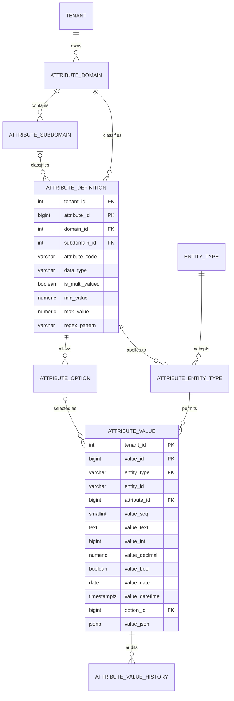

# Tenant-Aware Custom Attributes

A PostgreSQL design for storing any number of custom attributes on any table, for any number of tenants, without schema changes.

It is a **typed EAV (Entity-Attribute-Value)** model with:

- a **metadata catalog** organized by **domain** and **subdomain**
- a **polymorphic link** (`entity_type`, `entity_id`) so values can attach to any record
- **tenant isolation** through composite keys and row-level security

The full write-up, with the ERD and examples, is in `Tenant_Aware_Custom_Attributes_Design.pdf`.

---

## Contents

- [Key ideas](#key-ideas)
- [Data model](#data-model)
- [Quick start](#quick-start)
- [Usage](#usage)
- [What the database enforces](#what-the-database-enforces)
- [Pros](#pros)
- [Cons](#cons)
- [When to use it](#when-to-use-it)
- [Design decisions and alternatives](#design-decisions-and-alternatives)
- [Other databases](#other-databases)

---

## Key ideas

| Idea | How it works |
|---|---|
| **Attributes are data, not columns** | Adding an attribute is an `INSERT` into the catalog. No `ALTER TABLE`, no deployment. |
| **Tenant-specific catalog** | Every catalog and value table has `tenant_id`. Each tenant owns its attributes, codes and options. Two tenants can each define their own `color` with different options. |
| **Domain and subdomain** | `attribute_definition` belongs to a domain (`SALES`, `CRM`) and optionally a subdomain (`PRODUCT_SPECS`, `LOYALTY`). A foreign key makes sure the subdomain belongs to that domain. |
| **Values attach to any record** | `attribute_value` stores `entity_type` (which table, e.g. `PRODUCT`) and `entity_id` (that record's primary key). Products, customers, suppliers, or any future table can carry attributes. |
| **Typed storage** | One value column per data type (`value_int`, `value_date`, `option_id`, ...). A `CHECK` constraint requires exactly one to be filled. |

---

## Data model



`attribute_value.entity_id` points at a different table for each `entity_type`, so it is a **logical link, not a foreign key**. Cleanup triggers and an orphan-check query cover that gap.

### Tables

| Table | Scope | Purpose |
|---|---|---|
| `tenant` | System | Each business or organization that owns its own catalog. |
| `entity_type` | System | Kinds of records attributes can attach to, with source table and PK column. |
| `attribute_domain` | Tenant | Top-level business area (`SALES`, `CRM`). |
| `attribute_subdomain` | Tenant | Section inside a domain (`SALES > PRODUCT_SPECS`). |
| `attribute_definition` | Tenant | The catalog: code, data type, unit, min/max, max length, regex, flags. |
| `attribute_option` | Tenant | Allowed values for `OPTION` (dropdown) attributes. |
| `attribute_entity_type` | Tenant | Which attributes each entity type may use, with required flag, default, UI group, sort order. |
| `attribute_value` | Tenant | The values, keyed by tenant, entity type, entity ID, attribute and sequence. |
| `attribute_value_history` | Tenant | Audit trail of every insert, update and delete. |

### Database objects

| Object | Purpose |
|---|---|
| `trg_attribute_value_validate` | Checks type, single-value rule, min/max, max length, regex and active flag on every write. |
| `trg_attribute_value_audit` | Writes old and new values to `attribute_value_history`. |
| `fn_entity_attribute_cleanup` | Generic trigger for source tables. Deleting a record deletes its attribute values. |
| `set_attribute(...)` | Write API. Takes values as text and stores each in the right typed column. Upserts, so unchanged values are not rewritten. |
| `v_attribute_value` | Human-readable view, one row per value. |
| `v_entity_attributes_json` | One JSON document per record, for APIs or caching. |

---

## Quick start

Requires PostgreSQL 14 or later (tested on 16).

```bash
createdb attrdemo
psql -d attrdemo -f 01_schema.sql
psql -d attrdemo -f 02_sample_data.sql
psql -d attrdemo -f 03_queries.sql
psql -d attrdemo -f 04_validation_tests.sql
psql -d attrdemo -f 05_row_level_security.sql
```

| Script | Contents |
|---|---|
| `01_schema.sql` | Tables, constraints, indexes, triggers, `set_attribute()`, views, dialect notes. |
| `02_sample_data.sql` | Example source tables (`product`, `customer`, `supplier`), two tenants, domains, attributes, options and values. |
| `03_queries.sql` | Ten read patterns: record detail, multi-filter, pivot, cross-entity search, form metadata, catalog inventory, missing required, orphans, JSON, audit trail. |
| `04_validation_tests.sql` | Eleven bad writes that must be rejected, plus one valid write with orphan cleanup. Each prints `OK: ...`. |
| `05_row_level_security.sql` | `app_user` role, tenant policies on every table, and an isolation demo. Run last. |

---

## Usage

### 1. Register an entity type (once per table)

```sql
INSERT INTO entity_type (entity_type, display_name, source_table, pk_column)
VALUES ('PRODUCT', 'Product', 'product', 'product_id');

CREATE TRIGGER trg_product_attr_cleanup AFTER DELETE ON product
FOR EACH ROW EXECUTE FUNCTION fn_entity_attribute_cleanup('PRODUCT', 'product_id');
```

### 2. Define an attribute

```sql
-- definition (domain SALES, subdomain PRODUCT_SPECS)
INSERT INTO attribute_definition
      (tenant_id, domain_id, subdomain_id, attribute_code, display_name,
       data_type, unit_of_measure, min_value, max_value, is_filterable)
VALUES (1, :sales_domain_id, :specs_subdomain_id, 'battery_hours', 'Battery Life',
        'INTEGER', 'hours', 1, 48, TRUE);

-- allow it on products
INSERT INTO attribute_entity_type (tenant_id, attribute_id, entity_type, attribute_group)
VALUES (1, :battery_attribute_id, 'PRODUCT', 'Specs');
```

### 3. Write values

```sql
-- set_attribute(tenant_id, entity_type, entity_id, domain_code, attribute_code, values[])
SELECT set_attribute(1, 'PRODUCT',  '1',      'SALES', 'ram_gb', ARRAY['16']);
SELECT set_attribute(1, 'PRODUCT',  '2',      'SALES', 'color',  ARRAY['BLK','SLV']); -- multi-valued
SELECT set_attribute(1, 'CUSTOMER', 'C-1001', 'CRM',   'region', ARRAY['Florida']);
SELECT set_attribute(1, 'PRODUCT',  '2',      'SALES', 'color',  ARRAY[]::text[]);     -- clear
```

### 4. Read values

```sql
-- all attributes of one record
SELECT domain_code, subdomain_code, display_name, value_display, unit_of_measure
FROM   v_attribute_value
WHERE  tenant_id = 1 AND entity_type = 'PRODUCT' AND entity_id = '1';

-- one JSON document per record
SELECT attributes
FROM   v_entity_attributes_json
WHERE  tenant_id = 1 AND entity_type = 'PRODUCT' AND entity_id = '2';
-- {"color": ["BLK", "SLV"], "ram_gb": 12, "screen_size": 13.3}

-- cross-entity search: everything in Florida
SELECT v.entity_type, v.entity_id
FROM   attribute_value v
JOIN   attribute_definition a ON a.attribute_id = v.attribute_id
WHERE  v.tenant_id = 1 AND a.attribute_code = 'region' AND v.value_text = 'Florida';
```

See `03_queries.sql` for filtering, pivoting, form metadata and data-quality checks.

### 5. Tenant context (with row-level security)

The application connects as `app_user` and sets the tenant at the start of each request or transaction:

```sql
SET app.tenant_id = '1';
```

Connection pools must reset this between requests. A session with no tenant set sees no rows.

---

## What the database enforces

All of these are covered by `04_validation_tests.sql`.

| Bad write | Stopped by |
|---|---|
| Text such as `16GB` in an `INTEGER` attribute | Validation trigger |
| Number outside `min_value` / `max_value` | Validation trigger |
| Text failing `regex_pattern` or longer than `max_length` | Validation trigger |
| Second value for a single-valued attribute | Validation trigger |
| Two typed columns filled in one row | `CHECK ck_av_one_value` |
| Option code not in the list | `set_attribute` lookup; FK for direct inserts |
| Another tenant's option, or another attribute's option | FK on `(tenant_id, attribute_id, option_id)` |
| Attribute not allowed for the entity type | FK to `attribute_entity_type` |
| Unknown entity type | FK to `attribute_entity_type` / `entity_type` |
| Subdomain from a different domain | FK on `(tenant_id, domain_id, subdomain_id)` |
| Reading or writing another tenant's rows | Row-level security |
| Values left behind when a record is deleted | Cleanup trigger on each source table |
| Required attribute missing | **Not blocked on write**; reported by the data-quality query |

---

## Pros

- **One attribute service for the whole application.** Products, customers, suppliers and any future table get custom attributes by registering one `entity_type` row. No new tables per entity.
- **No schema changes for new attributes.** Adding an attribute is a couple of `INSERT`s. Business users or an admin screen can manage the catalog directly.
- **True multi-tenancy.** Each tenant owns its catalog, codes and options. Isolation is enforced by composite foreign keys and row-level security, not only by application code.
- **Organized catalog.** Domain and subdomain give admin screens, ownership and reporting a natural structure, and allow the same attribute code in different business areas (`region` in CRM and in PURCHASING).
- **Strong data quality for an EAV model.** Data type, range, regex, option ownership, single-value rules and entity-type applicability are all checked inside the database.
- **Fast, correct filtering.** Partial indexes on each typed column support range and equality filters (`RAM >= 16`), and numbers and dates sort correctly.
- **Metadata drives the application.** Forms, required fields, dropdowns, faceted filters and sort order can all be generated from the catalog, so one code path serves every entity type.
- **Cross-entity queries.** One query can search every record type, for example everything in a region.
- **Clean audit trail.** Every change is recorded per attribute, and `set_attribute` skips unchanged values, so history has no noise.
- **Partition-ready.** Keys and indexes lead with `tenant_id`, so `attribute_value` can be partitioned by tenant later without redesign.

## Cons

- **No real foreign key to the owning record.** `entity_id` cannot reference many tables at once. Cleanup triggers must be attached to every source table, and bulk deletes or `TRUNCATE` can bypass them, so the orphan check should run on a schedule.
- **Text entity IDs.** `entity_id` is `VARCHAR`, so joins need casts (`product_id::text`) and indexes are larger than with `BIGINT`.
- **Query complexity.** Simple questions need joins or pivots. Showing records with attributes as columns needs a `FILTER` / `CASE` pivot instead of `SELECT *`.
- **Multi-attribute filters cost more.** Each condition is a separate `EXISTS`; five filters means five lookups, slower than one `WHERE` on a wide table.
- **Row volume grows fast.** 1M records x 30 attributes = 30M value rows. Manageable with indexing and partitioning, but it needs planning.
- **More moving parts.** Nine tables, three triggers, a write function and a policy per table take longer to build, test, explain and maintain than a product-only design.
- **Trigger cost on writes.** Every value write runs a definition lookup and an audit insert. Bulk loads may need to disable triggers and validate with set-based queries instead.
- **Required attributes are checked after the fact.** A record and its attributes are written in separate statements, so missing required values are reported, not blocked.
- **Harder for BI tools and analysts.** Power BI, Tableau and ad-hoc SQL users expect columns, so pivoted views or wide reporting tables are needed downstream.
- **Session discipline for RLS.** Every connection must set `app.tenant_id`, and pooled connections must reset it. A mistake shows up as missing data rather than an error.

---

## When to use it

**Good fit**

- Many entity types need flexible, user-defined attributes.
- Several tenants or business units share one database but must not see each other's data or catalog.
- Attributes drive behavior: filtering, validation, required fields, forms built from metadata.
- The catalog changes often and should be managed without deployments.

**Not the best fit**

- Attributes rarely change and there are only a few entity types: real columns or a table per type are simpler and faster.
- Attributes are only stored and displayed, with no validation or filtering: a single `JSONB` column is less work.
- Analytics workloads: keep this model in the OLTP source and pivot into wide tables or a `VARIANT` column in the warehouse. Analysts should not query EAV directly.

**Recommended hybrid**

- Stable, universal fields (price, SKU, name, status) as real columns on each table.
- This design for the long tail of tenant-specific attributes.
- `v_entity_attributes_json` (or a materialized version) for fast reads.
- Pivoted wide tables for reporting.

---

## Design decisions and alternatives

| Decision | Chosen | Alternative, and when to prefer it |
|---|---|---|
| Link to the owning record | Polymorphic `(entity_type, entity_id)` | A central entity registry gives a real FK and cascade, but every record also needs a registry row. Prefer it when referential integrity outweighs the extra write. |
| `entity_id` type | `VARCHAR(100)` (numeric, UUID and natural keys) | `BIGINT` when every source table has a numeric key: smaller indexes, no casts. |
| Attribute code uniqueness | Per tenant + domain | Per tenant only, if a code should resolve without knowing the domain. |
| `entity_type` scope | Global (system) | Add `tenant_id` if tenants can register their own entity types. |
| Sub-types (laptop vs T-shirt) | Not modeled; subdomain groups attributes | Add `entity_subtype` to `attribute_entity_type` if required flags must differ by sub-type. |
| Read cache | `v_entity_attributes_json` view | Materialize it, or keep a `JSONB` column on hot tables, when read volume justifies the sync cost. |

---

## Other databases

- **SQL Server:** `IDENTITY` instead of `GENERATED ALWAYS AS IDENTITY`; `NVARCHAR(MAX)` with `ISJSON` instead of `JSONB`; `DATETIMEOFFSET` instead of `TIMESTAMPTZ`; set-based triggers on `inserted`; RLS through `SECURITY POLICY` with `SESSION_CONTEXT(N'tenant_id')`.
- **Snowflake:** foreign keys, `CHECK` and `UNIQUE` are not enforced, so run the validation as data-quality queries in the load pipeline; use a `ROW ACCESS POLICY` for tenant isolation; cluster `attribute_value` by `(tenant_id, entity_type, attribute_id)`.
